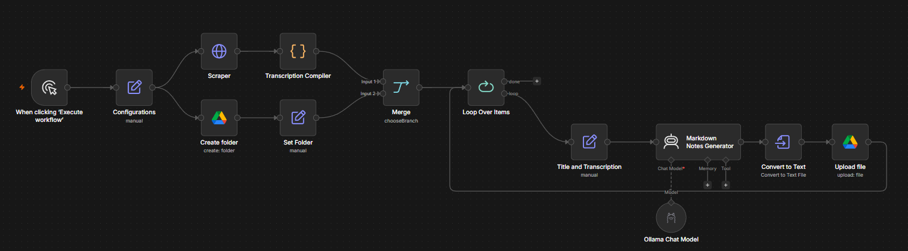

<h1 align="center">Coursera Markdown Notes</h1>

<p align="center"><b>A Playwright-powered automation that turns Coursera lecture transcripts into clean, organized Markdown study notes.</b></p>

<p align="center"><i>Watch the lecture once. Keep the notes forever.</i></p>

<p align="center">
A small FastAPI service drives a logged-in Chromium browser through a Coursera course, opens every lecture in a module and reads its transcript. An n8n workflow calls that service, hands each transcript to a local Ollama model that writes the study notes, and uploads one Markdown file per lecture into a Google Drive folder.
</p>

<p align="center">
  
  
  
  
  
  
  
  
</p>

## Preview

<p align="center">
  
</p>

<p align="center">
  
</p>

> Save a screenshot of the n8n canvas as `docs/n8n-workflow.png` and one of a generated note as `docs/notes-preview.png` to show them here.

## Runs locally

Everything except the final upload runs on your own computer. There's no hosted server, no paid AI API and no third-party account besides Coursera and Google Drive.

| Part | Where it runs |
| --- | --- |
| Scraper API (FastAPI + Playwright) | Your machine, on `localhost:8000` |
| Browser session | A headless Chromium on your machine, using the login saved in `auth.json` |
| Workflow | Your own n8n instance, installed with npm or Docker |
| Notes generator | Ollama, running a model on your own CPU or GPU |
| Storage | Google Drive, the only step that leaves your machine |

What this means:

- **Private.** Your Coursera session cookies and lecture transcripts stay on your computer. The model writes notes offline, and only the finished Markdown files are uploaded.
- **Free to run.** There are no per-request API costs, so you can generate notes for a whole course as often as you like.
- **Under your control.** You choose the Ollama model, edit the prompt in the Markdown Notes Generator node, and can point the upload step somewhere else, such as a local folder, if you'd rather not use Drive.

Keep `auth.json`, `coursera_profile/` and `.env` out of version control. They're already listed in `.gitignore`, because anyone holding `auth.json` can sign in as you.

## Architecture

```
n8n (Manual trigger → Configurations)
   │
   ├── Scraper (HTTP GET) ──► FastAPI + Playwright (this folder)
   │        │                     └── Chromium, logged in with auth.json
   │        ▼
   │   Transcription Compiler (Code)
   │
   └── Google Drive: Create folder → Set Folder
   │
   ▼
Merge → Loop Over Items → Title and Transcription
   → Markdown Notes Generator (Ollama chat model)
   → Convert to Text → Upload file to Google Drive
```

| Layer | Tech |
| --- | --- |
| Scraper | Python 3.12+, Playwright (Chromium) |
| API | FastAPI, served with Uvicorn |
| Workflow | n8n |
| Notes generator | Ollama chat model, running locally |
| Storage | Google Drive |

## Features

- Scrapes every lecture transcript in a chosen module with one request
- Reuses a saved Coursera login, so the scraper never types your password
- Works with personal accounts and with organization or university accounts through `COURSERA_LINK`
- Returns transcripts grouped by lecture title, ready for n8n to loop over
- Notes are written by a local model, so transcripts never leave your machine before they reach Drive

## Project structure

```
coursera_scraper/
├── main.py           # FastAPI app and the Playwright scraper
├── login.py          # One-time manual login that saves auth.json
├── .env.example      # Template for COURSERA_LINK
├── .env              # Your settings (git-ignored)
├── auth.json         # Saved Coursera session (git-ignored)
├── coursera_profile/ # Chrome profile used by login.py (git-ignored)
└── LICENSE
```

## Setup

You need Python 3.12 or newer, Google Chrome, n8n and Ollama.

1. Create a virtual environment and install the dependencies:

   ```powershell
   py -3.12 -m venv venv
   .\venv\Scripts\Activate.ps1
   pip install fastapi uvicorn playwright python-dotenv
   playwright install chromium
   ```

2. Copy `.env.example` to `.env` and set `COURSERA_LINK`:

   ```env
   # Personal account
   COURSERA_LINK=https://www.coursera.org

   # Organization or university account
   COURSERA_LINK=https://www.coursera.org/organizations/your-organization-slug
   ```

3. Log in to Coursera once. A Chrome window opens. Sign in, then press Enter in the terminal:

   ```powershell
   python login.py
   ```

   This saves your session to `auth.json`. Run it again whenever Coursera logs you out.

4. Start the API from this folder, so it can find `auth.json` and `.env`:

   ```powershell
   python -m uvicorn main:app --port 8000
   ```

   Leave off `--reload`. On Windows it switches the event loop and Playwright fails to launch the browser.

5. Open `http://localhost:8000/test`. You should see `"Successfull Test"`.

## API

| Method | Route | Description |
| --- | --- | --- |
| GET | `/scrape/{module_num}/{coursera_link}` | Scrape every lecture transcript in module `module_num` (counting from 1) of the course at `COURSERA_LINK/{coursera_link}` |
| GET | `/test` | Health check |
| GET | `/test/{module}/{coursera_path}` | Echoes the parameters back, to check what n8n is sending |

`coursera_link` is the course path after `COURSERA_LINK`, for example `learn/python-for-applied-data-science-ai`.

Example response:

```json
[
  { "Introduction to Python": ["Welcome to the course.", "In this video..."] },
  { "Types": ["Python has several data types.", "..."] }
]
```

## Connecting n8n

Point the **Scraper** HTTP Request node at:

```
http://localhost:8000/scrape/{{ $json.module }}/{{ $json.course }}
```

If n8n runs in Docker, use `http://host.docker.internal:8000` instead of `localhost`. A module with many lectures can take a few minutes, so raise the node's timeout if requests are cut off.

## License

MIT. See [LICENSE](LICENSE).
